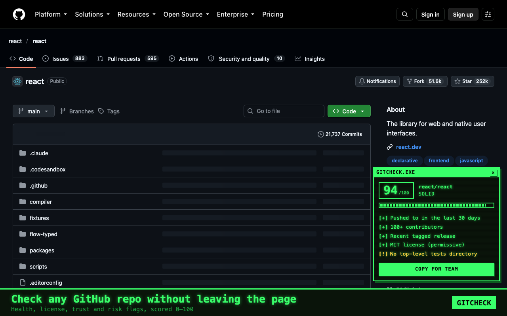
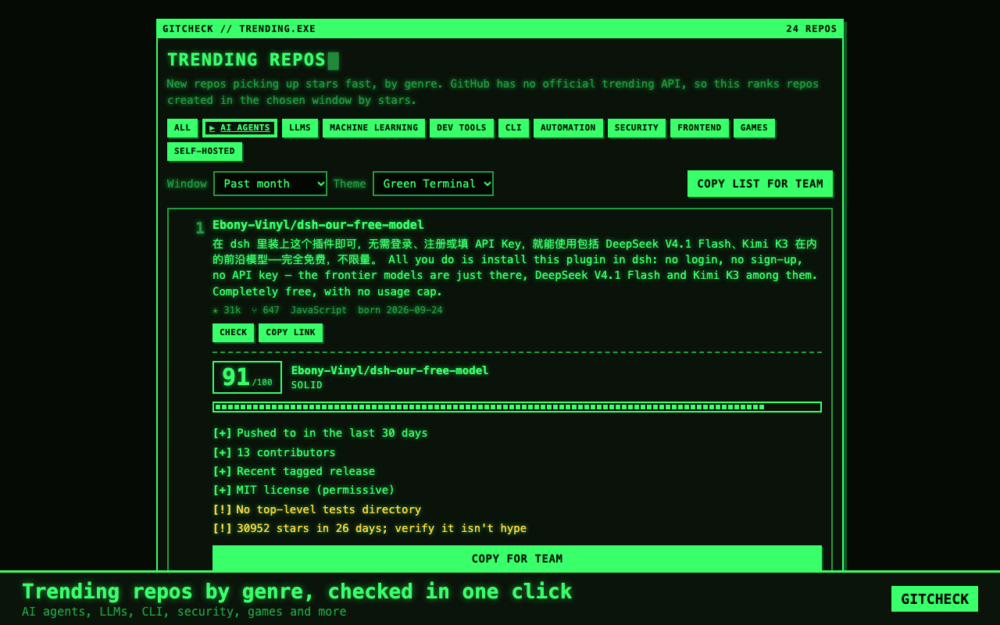
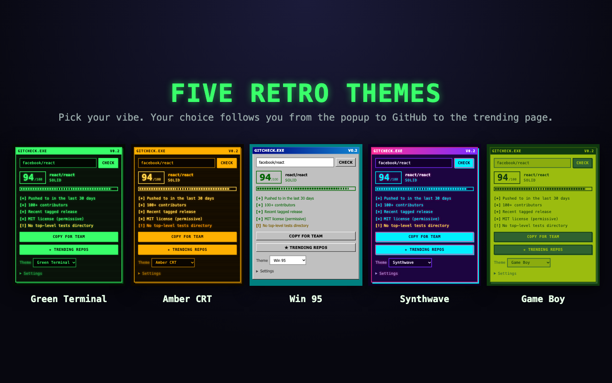

<p align="center"></p>

# GitCheck

**Vet any GitHub repo in one click.** A free, open-source Chrome extension that scores a repository 0–100, lists its green lights and red flags, and shows trending repos by genre. Retro UI, five themes.



## Features
- **On-page check**: a button on every repo page opens a themed panel with the score, flags, and a Markdown "Copy for team" summary.
- **Popup**: paste any repo URL, pick a theme, open Trending, and optionally add a GitHub token.
- **Trending page**: genre tabs (AI Agents, LLMs, ML, Dev Tools, CLI, Automation, Security, Frontend, Games, Self-Hosted), a time window, per-repo Check, and "Copy list for team".
- **Five themes**: Green Terminal, Amber CRT, Win 95, Synthwave, Game Boy.
- **Private**: no accounts, no analytics. It only talks to the public GitHub API. See the [privacy policy](store/privacy.html).

| Trending by genre | Five themes |
|---|---|
|  |  |

## Install (from source)
1. Clone or download this repo.
2. Open `chrome://extensions` and enable **Developer mode**.
3. Click **Load unpacked** and select the repo folder.
4. Open any `github.com/owner/repo` page and click **▶ GitCheck this repo**, or use the toolbar icon.

It works in other Chromium browsers (Edge, Brave, Arc) the same way.

## How scoring works (100 points)
| Area | Points | Looks at |
|---|---|---|
| Activity | 30 | Time since last push |
| Community | 20 | Stars (log scale) and contributor count |
| Maintenance | 20 | Tagged releases and open-issue load |
| License | 15 | Permissive / copyleft / non-standard / missing |
| Hygiene | 15 | Tests, CI, README, description |

Warning flags (no points): archived repo, fork, bus factor (one person made most commits), unusually few forks for the star count, and a brand-new repo with a huge star count.

The score is a quick heuristic to help you decide where to look, **not a security audit**. Tweak the weights in `src/vet.js`.

## Notes
- **"Trending" is an approximation.** GitHub has no trending API, so GitCheck ranks repos *created* in the chosen window by stars via the Search API. Results are cached for 30 minutes.
- **Rate limits.** Unauthenticated GitHub API use is limited (60 core requests/hour, 10 searches/minute). Add a personal access token in the popup's Settings to raise this. The token is stored only in your browser (`chrome.storage.local`) and sent only to `api.github.com`. A token with no scopes is enough, since GitCheck only reads public data.
- Each repo check makes 4 API requests.

## Project layout
```
manifest.json        MV3 manifest
src/vet.js           API calls + scoring
src/gc.css           retro design system (themes are --gc-* variable blocks)
src/theme.js         theme storage and switching
src/ui.js            shared report markup
src/content.*        on-page button and panel
src/popup.*          toolbar popup
src/trending.*       trending page
store/               Chrome Web Store listing copy, screenshots, privacy policy
```

## Adding a theme
Add a `[data-theme="yourtheme"]` block of `--gc-*` variables to `src/gc.css`, and an entry to `THEMES` in `src/theme.js`.

## Contributing
Issues and pull requests are welcome. Ideas: better scoring signals, more genres, a languages filter, Firefox support.

## License
[MIT](LICENSE). GitCheck is an independent project and is not affiliated with or endorsed by GitHub.
